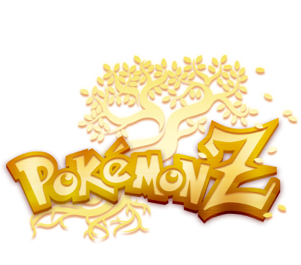
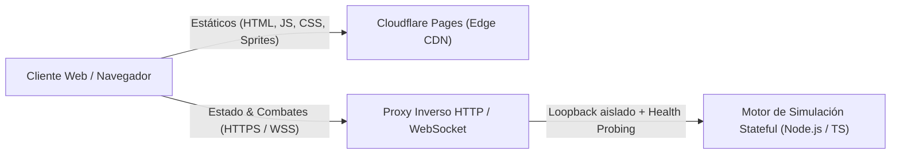

<div align="center">
  

  # Pokémon Z Showdown

  **Simulador competitivo multijugador en tiempo real para el fangame *Pokémon Z***  
  *Arquitectura cliente-servidor desacoplada (Edge CDN + Backend Stateful WebSocket)*

  [**Jugar Online**](https://pokemonz-showdown.pages.dev) · [Formatos](#formatos-y-contenido) · [Arquitectura](#arquitectura-y-sistemas) · [Self-Hosting](#guía-de-self-hosting)
</div>

---

**Stack tecnológico:** `TypeScript` · `Node.js` · `WebSockets (WSS)` · `Reverse Proxy HTTP/WS` · `Cloudflare Pages` · `Render`

---

## Arquitectura y Sistemas

El proyecto separa la entrega de contenido estático de la simulación de combates en tiempo real para maximizar la estabilidad y minimizar el consumo de recursos en el servidor origen:



- **Desacoplamiento Edge / Origen**: Los recursos estáticos y datos del *Teambuilder* se distribuyen desde CDN en el borde (**Cloudflare Pages**), redirigiendo el tráfico web estándar desde el origen para reservar el servidor de aplicaciones casi en exclusiva a conexiones persistentes **WebSocket** y endpoints de estado.
- **Proxy inverso y túnel WebSocket**: Un punto de entrada único gestiona peticiones HTTP, CORS multi-origen y *upgrades* de WebSocket hacia el motor de combates escuchando en interfaz interna aislada (*loopback*), sin exponer directamente el proceso backend al exterior.
- **Optimización HTTP y caché**: Compresión dinámica (`Brotli` / `Gzip`) con caché acotada en memoria, revalidación condicional por `ETag`, políticas `Cache-Control` diferenciadas por tipo de recurso y versionado por hash en assets estáticos.
- **Orquestación y control de recursos**: Arranque coordinado entre backend y frontend mediante comprobación activa de salud (*health probing*), apagado ordenado ante señales POSIX (`SIGINT`/`SIGTERM`), perfil de bajo consumo de RAM para entornos PaaS restringidos y límite configurable de usuarios concurrentes.
- **Seguridad y servidor autoritativo**: Toda la validación de equipos y la lógica de combate se ejecutan exclusivamente en servidor (*authoritative server*). Incluye aislamiento de proxy confiable (`X-Forwarded-For`), autenticación administrativa local con derivación criptográfica (`scrypt` + comparación en tiempo constante), prevención de *path traversal* y cabeceras HTTP de endurecimiento.

---

## Formatos y Contenido

- **9 formatos exclusivos de Pokémon Z**:
  - **`[Gen 9] Pokemon Z Random Battle`**, **`[Gen 9] Pokemon Z Random Doubles`** y **`[Gen 9] Pokemon Z Random FFA`**: combates con equipos aleatorios generados con especies, formas regionales, Megas Z, habilidades y objetos del mod (1v1, 2v2 y *Battle Royale* de 4 jugadores).
  - **`[Gen 9] Pokemon Z Custom Singles`** y **`[Gen 9] Pokemon Z Custom Doubles`**: formato estándar con mecánicas de **Generación 9** y **Megaevolución** activa (sin Teracristalización ni baneos de OU), con `Item Clause` y `Sleep Clause`.
  - **`[Gen 9] Pokemon Z Libre`** y **`[Gen 9] Pokemon Z Libre Doubles`**: sin restricciones de especies repetidas, objetos o cláusulas, hasta **24 Pokémon** por equipo y nivel libre (1–9999), pensado para **Randomlockes** y partidas personalizadas.
  - **`[Gen 9] Pokemon Z Free-For-All`** y **`[Gen 9] Pokemon Z Libre FFA`**: combates todos contra todos para 4 jugadores.
- **Datos y mecánicas del fangame**:
  - Formas regionales propias de Pokémon Z (`-Kalos`, `Pikachu-Kalos-Z`, `Rotom-Z`) coexistiendo de forma independiente junto a sus especies originales.
  - Especies inéditas del juego, nuevas Megaevoluciones (incluidas Mega-Z), rebalanceos competitivos, habilidades y movimientos personalizados.
  - Megapiedras y objetos competitivos exclusivos (como *Nudillo Púas*, *Punzasfera*, *Casco Protector*, *Coraza Asalto*, *Supermin. Evolutivo*, etc.) integrados en el *Teambuilder* con sus iconos y validaciones.

---

## Guía de Self-Hosting

Si quieres desplegar una instancia privada para torneos, pruebas o Randomlockes con amigos:

**Requisitos:** `Node.js >= 22.18.0` y `Git`.

<details>
<summary><strong>Opción 1: En tu propio PC (Windows / Linux / macOS)</strong></summary>

1. Clona el repositorio, instala dependencias y compila el proyecto:
   ```bash
   git clone https://github.com/An1Enrique/pokemonZ-showdown.git
   cd pokemonZ-showdown
   npm run build
   ```
2. Inicia el servidor y el cliente web:
   ```bash
   npm start
   ```
   El cliente queda disponible en `http://localhost:8080`.
3. Para compartirlo con amigos desde casa sin abrir puertos en el router, puedes usar un túnel TLS automático con Cloudflare:
   ```bash
   cloudflared tunnel --url http://localhost:8080
   ```

</details>

<details>
<summary><strong>Opción 2: Gratis en la nube con Render</strong></summary>

El repositorio incluye `render.yaml` listo para **Render Free**:

1. Haz **Fork** de este repositorio en GitHub.
2. En [Render](https://render.com), selecciona **New + → Blueprint** (o **Web Service**) conectado a tu fork.
3. Configuración recomendada:
   - **Build Command:** `npm run build`
   - **Start Command:** `npm start`
   - **Variables:** `NODE_VERSION=22.18.0` y `LOW_MEMORY=1`

</details>

<details>
<summary><strong>Opción 3: En un VPS (Ubuntu / Debian) 24/7</strong></summary>

```bash
git clone https://github.com/An1Enrique/pokemonZ-showdown.git
cd pokemonZ-showdown
npm run build
LOW_MEMORY=1 PORT=8080 pm2 start start.js --name pokemonz-showdown
pm2 save
```

Se recomienda situar delante un proxy inverso con TLS (**Nginx** o **Caddy**) en los puertos `80`/`443` apuntando al servicio local. Variables útiles de entorno: `PORT`, `HOST`, `BACKEND_PORT`, `LOW_MEMORY` y `MAX_USERS`.

</details>

---

## Créditos

- **Pokémon Z** (fangame, diseños, sprites, mecánicas y balances): **Eric Lostie** y el equipo de Pokémon Z.
- **Pokémon Showdown** (motor base): Smogon / Zarel y colaboradores.
